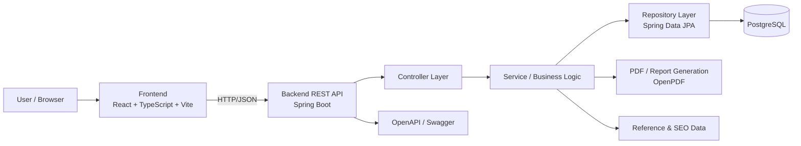

# Global Education & Career ROI Calculator

*A Full-Stack Education Return on Investment Analysis Platform*

[](https://www.oracle.com/java/)
[](https://spring.io/projects/spring-boot)
[](https://react.dev/)
[](https://www.typescriptlang.org/)
[](https://www.postgresql.org/)
[](https://docs.docker.com/compose/)

## Academic Project Summary / Abstract

The Global Education & Career ROI Calculator is a B.Tech final-year academic project developed at Noida International University, School of Engineering and Technology, in the Department of Computer Science and Engineering during the 2025–2026 academic year. The project addresses the difficulty students and families face when evaluating higher education as a financial decision. Tuition fees, living costs, opportunity costs, tax assumptions, and post-graduation earnings vary widely across countries, institutions, and academic disciplines, making manual comparison unreliable.

This project implements a full-stack decision-support platform for estimating and comparing education return on investment. The backend is built with Java 17 and Spring Boot 3.2, exposing REST APIs for ROI calculation, simulation, comparison, shareable results, reference data, SEO page data, career intelligence, decision confidence, degree-worth-it insights, and PDF report generation. PostgreSQL is used for persistent storage through Spring Data JPA and Hibernate. The frontend is implemented with React 18, TypeScript, Vite, Tailwind CSS, shadcn/ui, TanStack Query, and Recharts to provide calculator workflows, result visualisation, comparison views, and reference-data exploration.

The repository contains the submitted 40-page final-year project report, backend source code, frontend source code, and deployment configuration. The system is presented as an academic engineering project; revenue, traffic, and large-scale deployment targets mentioned in planning documents are treated as future or proposed goals unless verified in the implementation.

## Problem Statement

Higher education decisions often involve substantial long-term financial commitment. Prospective students may compare institutions based on reputation or tuition alone, without a consistent way to evaluate total education cost, foregone income, expected post-study earnings, break-even period, or net financial return. The problem addressed by this project is the lack of an accessible, structured platform that combines financial modelling with country, university, major, and currency reference data to support education pathway decisions.

## Project Objectives

The following objectives are based on the submitted project report and are presented as project goals:

- Design and implement a multi-variable education ROI computation engine using financial formulas and precise arithmetic.
- Build a layered Spring Boot REST API with separation of controller, service, repository, DTO, and entity responsibilities.
- Persist calculation and reference data in PostgreSQL, including support for shareable calculation records.
- Support reference data for countries, currencies, majors, degree levels, universities, and related financial inputs.
- Provide comparison and decision-support functionality for evaluating alternative education pathways.
- Implement supporting modules for programmatic SEO/content delivery, monetisation-ready data structures, and deployment configuration.
- Apply validation, security, documentation, and production-oriented engineering practices appropriate for a scalable web application.

## Methodology and System Implementation

### Development Approach

The project was implemented as a full-stack web application with a REST API backend and a single-page frontend. The codebase follows a layered architecture: controllers handle HTTP requests, services contain business logic, repositories manage persistence, and DTOs/entities define API and database models. The submitted report describes the project as a production-oriented academic prototype; this README distinguishes implemented features from planned or proposed extensions.

### Frontend

The frontend in [`frontend/`](./frontend/) is a React 18 + TypeScript application built with Vite. It uses React Router for routing, TanStack Query for API state management, Axios for HTTP requests, Tailwind CSS and shadcn/ui for UI components, Recharts for charts, Framer Motion for animations, and i18next for internationalisation support. Implemented routes include calculator, results, share redirect, comparison, countries, majors, degree-worth-it insight, SEO pages, blog pages, and legal pages.

### Backend REST API

The backend in [`backend/`](./backend/) is a Spring Boot 3.2 application running on Java 17. It exposes REST endpoints under `/api/v1` for ROI calculation, simulation, comparison, report generation, reference data, SEO pages, career intelligence, decision confidence, and degree-worth-it insights. OpenAPI/Swagger documentation is configured through springdoc.

### Service and Data Layers

Business logic is implemented in service classes such as ROI calculation, simulation, comparison, career intelligence, decision confidence, degree-worth-it, SEO, and report services. Spring Data JPA repositories provide database access. Entities and DTOs model reference data, calculations, SEO content, and supporting domain objects.

### Database and Persistence

PostgreSQL is the configured primary database. Hibernate/JPA manages object-relational mapping. SQL seed files are included for reference and supplemental data. Redis is present as an optional dependency/configuration for caching, but it is not required to understand the core project design. H2 is included as a test dependency.

### Financial Calculation Engine

The ROI-related implementation includes cost, projection, break-even, and comparison logic in backend services. The submitted report describes compound financial modelling, inflation/tax adjustments, opportunity cost, and year-by-year breakdowns. Because this repository is being presented for academic review, detailed financial claims should be interpreted in line with the submitted report and the current source code.

## Major Features

| Area | Status | Notes |
| --- | --- | --- |
| ROI calculation API (`/api/v1/roi/calculate`, `/quick-estimate`, `/share/{uuid}`) | Implemented | Controller and service classes are present in the backend. |
| ROI simulation (`/api/v1/roi/simulate`) | Implemented | Simulation controller/service and DTOs are present. |
| Comparison (`/api/v1/compare`) | Implemented | Comparison endpoint and frontend compare page are present. |
| Reference data APIs | Implemented | Countries, majors, degree levels, universities, and currencies endpoints are present. |
| PDF ROI report (`/api/v1/reports/roi/pdf/{uuid}`) | Implemented | OpenPDF dependency and report service/controller are present. |
| Career intelligence, decision confidence, degree-worth-it insights | Implemented in codebase | Endpoints and frontend/result components are present; validation depth should be reviewed as academic prototype functionality. |
| Programmatic SEO endpoints/pages | Partially implemented / prototype | SEO controller, entities, repositories, seed data, and frontend SEO page exist; large-scale generation targets are not presented as achieved results. |
| Ad zones / affiliate / lead entities | Partially implemented / data-model support | Related entities/repositories exist; no production monetisation results are claimed. |
| Authentication/premium tier | Proposed / limited | Spring Security and JWT dependencies exist, but the project should not be presented as a complete authenticated product. |
| Live exchange rates, ML salary prediction, production-scale traffic | Proposed / future work | Mentioned as roadmap or design targets, not verified achieved outcomes. |

## Technical Architecture



## Technology Stack

### Frontend

| Technology | Version / Notes | Evidence |
| --- | --- | --- |
| React | 18.3.1 | [`frontend/package.json`](./frontend/package.json) |
| TypeScript | 5.8.3 | [`frontend/package.json`](./frontend/package.json) |
| Vite | 5.4.19 | [`frontend/package.json`](./frontend/package.json) |
| Tailwind CSS | 3.4.17 | [`frontend/package.json`](./frontend/package.json) |
| shadcn/ui / Radix UI | Radix components present | [`frontend/package.json`](./frontend/package.json) |
| TanStack Query | 5.83.0 | [`frontend/package.json`](./frontend/package.json) |
| Recharts | 2.15.4 | [`frontend/package.json`](./frontend/package.json) |
| Vitest | 3.2.4 | [`frontend/package.json`](./frontend/package.json) |

### Backend

| Technology | Version / Notes | Evidence |
| --- | --- | --- |
| Java | 17 | [`backend/pom.xml`](./backend/pom.xml) |
| Spring Boot | 3.2.2 | [`backend/pom.xml`](./backend/pom.xml) |
| Spring Web / Validation / Security / Actuator | Spring Boot starters | [`backend/pom.xml`](./backend/pom.xml) |
| Spring Data JPA / Hibernate | JPA starter | [`backend/pom.xml`](./backend/pom.xml) |
| PostgreSQL JDBC Driver | Runtime dependency | [`backend/pom.xml`](./backend/pom.xml) |
| Springdoc OpenAPI | 2.3.0 | [`backend/pom.xml`](./backend/pom.xml) |
| OpenPDF | 1.3.30 | [`backend/pom.xml`](./backend/pom.xml) |

### Database

| Technology | Role | Evidence |
| --- | --- | --- |
| PostgreSQL | Primary application database | [`backend/pom.xml`](./backend/pom.xml), [`backend/docker-compose.yml`](./backend/docker-compose.yml) |
| Redis | Optional cache dependency/service | [`backend/pom.xml`](./backend/pom.xml), [`backend/docker-compose.yml`](./backend/docker-compose.yml) |
| H2 | Test dependency | [`backend/pom.xml`](./backend/pom.xml) |

### Development and Deployment Tools

| Tool | Purpose | Evidence |
| --- | --- | --- |
| Maven | Backend build and dependency management | [`backend/pom.xml`](./backend/pom.xml) |
| npm | Frontend package management | [`frontend/package.json`](./frontend/package.json) |
| Docker / Docker Compose | Local containerised setup | [`backend/Dockerfile`](./backend/Dockerfile), [`backend/docker-compose.yml`](./backend/docker-compose.yml) |
| Spring Actuator | Health/info endpoints | [`backend/pom.xml`](./backend/pom.xml) |
| Swagger UI | API documentation UI | [`backend/pom.xml`](./backend/pom.xml) |

## Repository Structure

```text
.
├── README.md                           # Root academic/project documentation
├── .env.example                        # Root environment variable example
├── .gitignore                          # Git ignore rules
├── backend/                            # Spring Boot backend
│   ├── Dockerfile
│   ├── docker-compose.yml
│   ├── pom.xml
│   ├── README.md
│   └── src/main/java/com/roicalculator/
│       ├── controller/                 # REST controllers
│       ├── service/                    # Business logic
│       ├── repository/                 # Spring Data JPA repositories
│       ├── domain/entity/              # JPA entities
│       ├── dto/                        # Request/response DTOs
│       └── config/                     # Configuration/security/exception handling
├── docs/                               # Academic documentation
│   ├── Project_Summary.pdf
│   └── Project-Report on ROI CALCULATOR.pdf
└── frontend/                           # React + TypeScript frontend
    ├── package.json
    ├── src/
    │   ├── pages/                      # Route-level pages
    │   ├── components/                 # UI and feature components
    │   ├── lib/                        # API/utilities
    │   └── test/                       # Frontend tests
    └── public/                         # Static assets
```

## Complete Final-Year Project Report

The complete submitted academic report is available in the repository:

- [docs/Project-Report on ROI CALCULATOR.pdf](<./docs/Project-Report on ROI CALCULATOR.pdf>)

For the Passau application project summary, see:

- [docs/Project_Summary.pdf](./docs/Project_Summary.pdf)

The original report file has been preserved and is not modified by this documentation update.

## Source Code

- Backend source: [`backend/src/main/java/com/roicalculator`](./backend/src/main/java/com/roicalculator)
- Frontend source: [`frontend/src`](./frontend/src)
- Backend README: [`backend/README.md`](./backend/README.md)
- Frontend README: [`frontend/README.md`](./frontend/README.md)
- Docker configuration: [`backend/Dockerfile`](./backend/Dockerfile), [`backend/docker-compose.yml`](./backend/docker-compose.yml)
- API documentation (when backend runs locally): `http://localhost:8080/swagger-ui.html`

## Live Demonstration

No verified public frontend or backend deployment URL was identified in the repository configuration during this documentation review. The repository includes local Docker/development configuration, but a live demo link is omitted rather than inferred.

## Testing

Evidence of tests currently present in the repository:

- Frontend Vitest tests: [`frontend/src/test/api.test.ts`](./frontend/src/test/api.test.ts), [`frontend/src/test/example.test.ts`](./frontend/src/test/example.test.ts), [`frontend/src/test/theme.test.tsx`](./frontend/src/test/theme.test.tsx)
- Backend test dependencies are configured in [`backend/pom.xml`](./backend/pom.xml), including `spring-boot-starter-test` and H2.

No claim is made that comprehensive integration, performance, security, or load testing has been completed unless separately documented with evidence.

## Limitations and Future Improvements

As documented in the submitted report and reflected by the current repository state:

- **Data freshness:** Exchange rates, salary statistics, and cost-of-living data may require periodic updates or live integrations.
- **Authentication scope:** Security/JWT dependencies exist, but a complete end-user authentication/premium flow should not be assumed.
- **Scalability claims:** Large-scale traffic, SEO page-count, and revenue targets are planning goals, not verified achieved results.
- **Validation depth:** Financial outputs should be validated against authoritative datasets before external production use.
- **Deployment hardening:** Production deployment would require managed secrets, secure CORS/origin configuration, HTTPS, monitoring, backups, and environment-specific configuration.

## Team and Academic Authorship

The submitted final-year project report documents this project as a group academic submission:

- **Karan Sahani** — BT/CS/2201/085
- **Minhaj Ahmad** — BT/CS/2201/099
- **Bittu Pd Mandal** — BT/CS/2201/055

**Project guide:** Ms. Jyoti Mahur, Assistant Professor, Department of Computer Science and Engineering, Noida International University.

This repository preserves the original group authorship. Individual contribution details for University of Passau application forms should be provided separately by the applicant and should not be inferred from this README.

## Local Development

### Backend

```bash
cd backend
mvn spring-boot:run
```

### Frontend

```bash
cd frontend
npm install
npm run dev
```

For Docker-based backend setup, see [`backend/docker-compose.yml`](./backend/docker-compose.yml). Before using Docker Compose outside local development, replace default credentials and review environment-specific settings.
 environment-specific settings.
